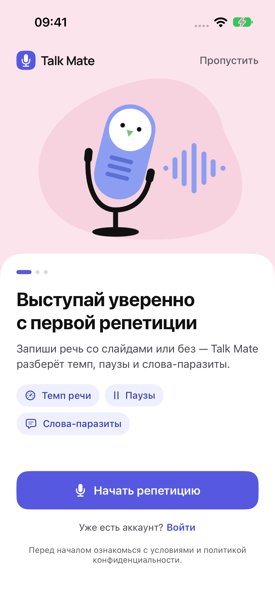
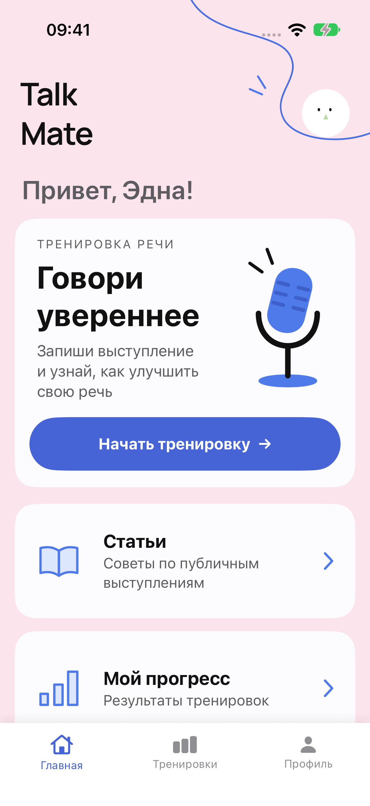
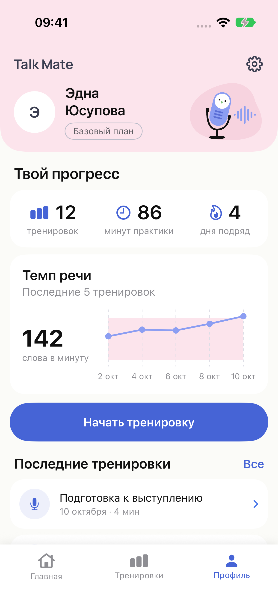
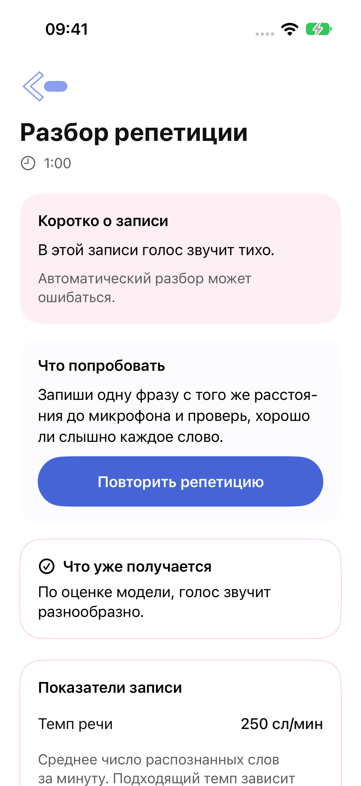
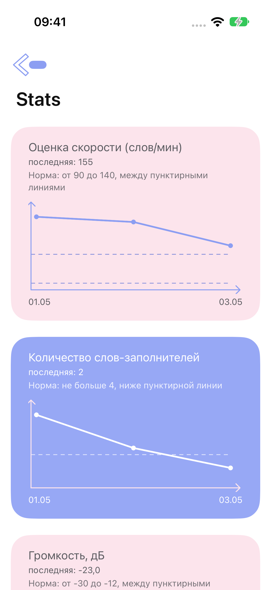

# Инструкция пользователя TalkMate

Скриншоты показывают актуальную iOS-версию. На Android расположение элементов может отличаться.

## Регистрация и вход

При первом запуске откроется экран с кнопкой **Создать аккаунт**. Нажмите её, введите имя, электронную почту и пароль не короче шести символов. Телефон, дату рождения (в формате ДД.ММ.ГГГГ, её можно выбрать в календаре по значку в поле) и пол можно не указывать. После регистрации вы сразу попадёте на главный экран.

Если учётная запись уже есть, нажмите «Войти» под кнопкой и введите email с паролем. Если пароль забыт, нажмите «Забыли пароль?» под кнопкой входа: на почту придёт код из шести цифр, его нужно ввести вместе с новым паролем. Приложение запоминает вход, в следующий раз оно откроется с главного экрана.

На каждом экране, кроме главного, в левом верхнем углу есть стрелка «назад».

## Язык

Приложение работает на русском и английском. По умолчанию язык берётся из настроек телефона: на русском телефоне интерфейс русский, на любом другом английский. Сменить его можно в настройках профиля (шестерёнка в личном кабинете): строка «Язык» предлагает «Как в системе», «Русский» и «English».

Язык выступления выбирать не нужно. Сервер сам определяет, на русском или на английском вы говорили, и разбирает запись по правилам этого языка: у английской речи свои слова-заполнители и своя норма темпа, 110–170 слов в минуту. Пояснения приходят на языке интерфейса.

## Главный экран

На нём три карточки: тренировка, «Статьи» и «Мой прогресс». Кружок с лицом в правом верхнем углу открывает личный кабинет.

## Личный кабинет

Внизу экрана три раздела: «Главная», «Тренировки» и «Профиль». В профиле собрано всё о ваших занятиях:

- сколько тренировок вы записали, сколько минут говорили и сколько дней подряд занимаетесь (сегодняшний день без тренировки серию ещё не обрывает);
- темп речи в пяти последних тренировках на фоне полосы нормы;
- две последние тренировки. Нажмите на любую, чтобы открыть её разбор. Ссылка «Все» и раздел «Тренировки» показывают весь список.

Названием тренировки служит её основная мысль. Шестерёнка в правом верхнем углу открывает настройки: язык, адрес сервера и выход. Строка «Базовый план» и карточка с тарифами пока ничего не меняют: все функции приложения открыты бесплатно.

## Тренировка

1. Откройте «Тренировку» и нажмите круглую кнопку слева. При первом запуске телефон спросит разрешение на запись звука.
2. Говорите. Таймер показывает длительность записи. Левая кнопка ставит запись на паузу и продолжает её, правая останавливает.
3. Нажмите **Анализ**. Запись уйдёт на сервер, разбор занимает от нескольких секунд до минуты в зависимости от длины выступления.

Если выступление идёт со слайдами, до нажатия «Анализ» прикрепите презентацию кнопкой «Прикрепить презентацию (PDF)». Слайд появится на экране записи. Листайте презентацию кнопками «Назад» и «Дальше» по ходу выступления: приложение запомнит, когда вы переключили слайд, и время на каждый слайд в результатах будет точным. Сервер прочитает слайды и сравнит их с речью. Файл нужен в формате PDF, не больше 40 МБ и 40 слайдов; из PowerPoint и Keynote его даёт экспорт в PDF.

Запись короче трёх секунд приложение не отправляет. Держите телефон в 20–30 сантиметрах от лица и записывайтесь в тихом помещении, иначе оценка громкости будет неточной.

## Результаты

В iOS сначала показаны итог и главное действие для следующей репетиции. Метрики, содержание и расшифровка доступны в подробностях. Кнопка повторной записи позволяет сразу начать новую репетицию. Ниже описаны показатели разбора; их расположение зависит от платформы.

| Строка | Что означает |
| --- | --- |
| Скорость | Сколько слов в минуту вы произносите. Сервер сравнивает темп с диапазоном для языка записи; это ориентир, а не универсальная оценка выступления |
| Громкость | «тихая», «нормальная» или «громкая» |
| Монотонность | «выразительная», если голос меняется по высоте, и «монотонная», если он звучит на одной ноте |
| Эмоция речи | Предположение модели по звучанию голоса, которое может быть ошибочным: нейтральная, интерес, счастье, грусть, страх, злость, отвращение |
| Кол-во заполнителей | Сколько раз прозвучали «ну», «вот», «как бы» и похожие слова. Под строкой перечислены самые частые |

В таблице есть строка «Чёткость речи»: насколько разборчиво вы говорили, в процентах. На неё влияют и шум вокруг, и расстояние до микрофона.

Под таблицей стоит блок о содержании. «Основная мысль» пересказывает одной фразой, о чём было выступление, рядом стоят ключевые слова. Пересказ составляет небольшая модель, на коротких и сбивчивых записях она ошибается. «Структура» говорит, есть ли в выступлении вступление, связки между мыслями и заключение. Для оценки структуры нужно хотя бы 40 слов.

Если к записи приложена презентация, следом идёт блок «Презентация и речь». В нём написано, какую долю написанного на слайдах вы раскрыли словами и какую долю речи прочитали со слайдов. Ниже перечислены замечания и строка на каждый слайд: сколько времени на него ушло, раскрыт ли он, какие слова со слайда не прозвучали, много ли на нём текста и не мелкий ли шрифт. Если вы листали слайды в приложении, время на слайд взято из ваших переключений. Если нет, приложение оценивает его по словам, и на слайдах без текста оно приблизительное. Пометка «пересказан своими словами» означает, что слов со слайда вы почти не произнесли, но говорили о том же. Надписи латиницей с русской речью не сверяются.

Ниже идут рекомендации: что поправить в следующий раз. Главное действие выделено жирным.

Под рекомендациями есть кнопка «Показать расшифровку». Она открывает текст, который приложение услышало в записи, разбитый на фразы. Слова-заполнители выделены розовым. Над фразой стоит подпись, если она сказана слишком быстро или медленно либо в голосе слышна эмоция: так видно, в каком именно месте выступления это случилось.

## Статьи

Короткие материалы о подготовке к выступлению: жесты, разогрев голоса, работа со слайдами. Нажмите на карточку, чтобы открыть текст.

## Мой прогресс

Графики показывают, как менялись ваши показатели от записи к записи. Светлая полоса на графике отмечает норму. Раздел заполняется после первой тренировки.

## Если появился экран «Ooops…»

Приложение не смогло получить ответ от сервера. Проверьте интернет и нажмите «Попробовать снова». Стрелка в левом верхнем углу возвращает на предыдущий экран. Запись при этом не теряется: после возврата на экран тренировки можно снова нажать «Анализ».

Сообщение «Не удалось распознать речь» означает, что в записи не нашлось слов. Запишитесь ещё раз ближе к микрофону.
